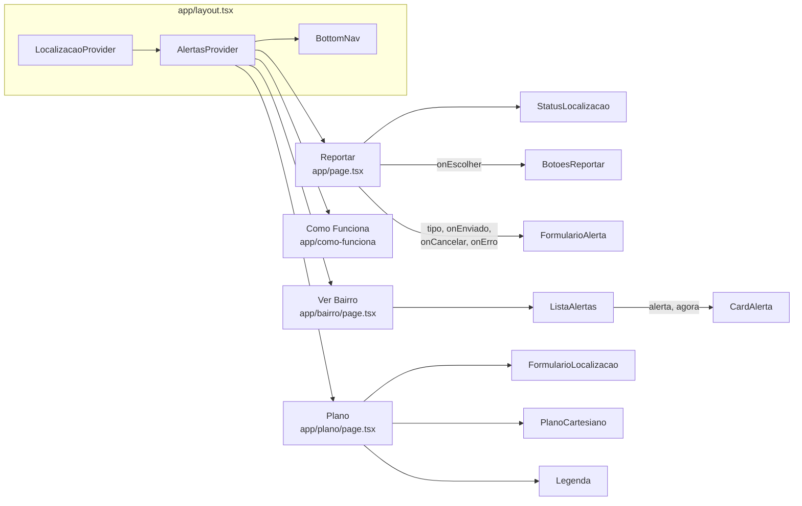
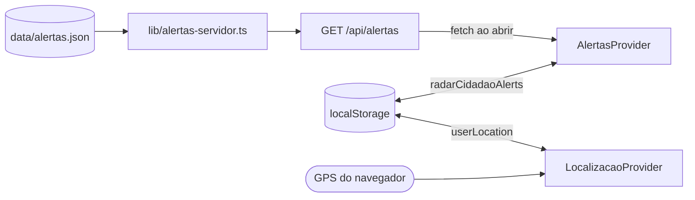
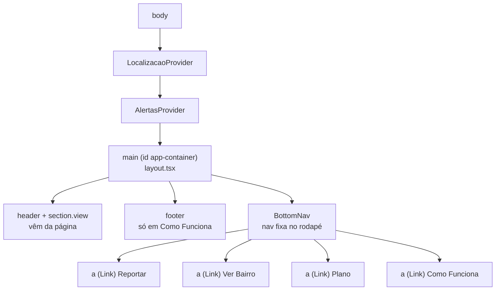
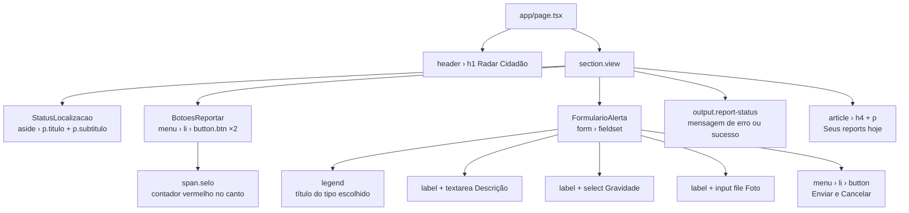
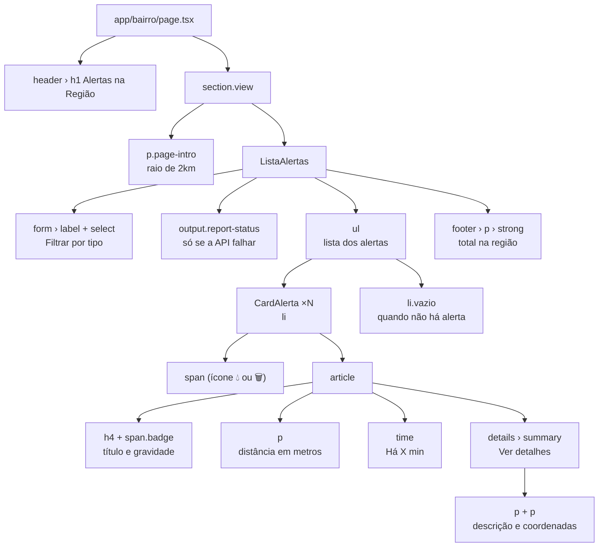
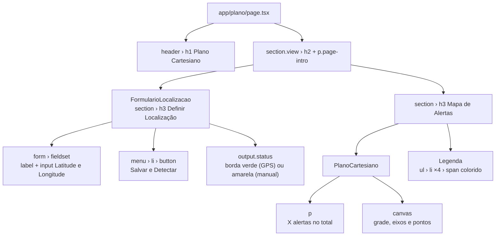
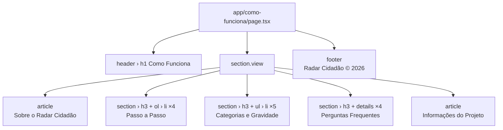

# Radar Cidadão

Plataforma colaborativa para registrar problemas urbanos, como **alagamentos** e **acúmulo de lixo**, e acompanhar os alertas da sua região num plano cartesiano montado a partir da sua localização.

Projeto acadêmico da disciplina de Desenvolvimento Web Mobile, na Universidade Presbiteriana Mackenzie.

## Funcionalidades

- **Reportar:** envie um alerta de alagamento ou lixo com descrição e gravidade (leve, moderado ou urgente). Cada botão mostra quantos alertas daquele tipo já existem.
- **Ver Bairro:** veja os alertas num raio de 2 km, do mais próximo ao mais distante, com filtro por tipo.
- **Plano:** defina sua localização pelo GPS ou digitando latitude e longitude, e veja você e os alertas num plano cartesiano desenhado em Canvas.
- **Como Funciona:** passo a passo de uso e perguntas frequentes.
- Funciona sem cadastro, e os alertas criados ficam salvos no navegador.

## Tecnologias

- [Next.js 16](https://nextjs.org) (App Router)
- React 19 e TypeScript
- CSS Modules e variáveis CSS
- Canvas 2D para o plano cartesiano
- Geolocation API e localStorage

## Como rodar

Pré-requisitos: Node.js 20.9 ou superior.

```bash
git clone https://github.com/<usuario>/Projeto_WebMobile.git
cd Projeto_WebMobile
npm install
npm run dev
```

Acesse [http://localhost:3000](http://localhost:3000).

> O navegador só libera o GPS em `localhost` ou em HTTPS. Para testar em outra máquina sem HTTPS, use a localização manual na tela **Plano** (ex.: `-23.5505` e `-46.6333`).

### Scripts

| Comando | O que faz |
| --- | --- |
| `npm run dev` | Inicia o servidor de desenvolvimento |
| `npm run build` | Gera o build de produção |
| `npm start` | Roda o build de produção |
| `npm run lint` | Verifica o código com ESLint |

## Estrutura

```
app/
├── layout.tsx              # layout, providers e navegação inferior
├── globals.css             # tokens, reset e classes compartilhadas
├── page.tsx                # Reportar (/)
├── bairro/page.tsx         # Ver Bairro
├── plano/page.tsx          # Plano cartesiano
├── como-funciona/page.tsx  # Como Funciona
└── api/alertas/
    ├── route.ts            # GET /api/alertas
    └── [id]/route.ts       # GET /api/alertas/:id
components/                 # cada componente tem o seu .module.css
├── BottomNav.tsx           # navegação inferior
├── StatusLocalizacao.tsx   # cartão de status da localização
├── BotoesReportar.tsx      # botões de tipo com contador
├── FormularioAlerta.tsx    # formulário de novo alerta
├── ListaAlertas.tsx        # filtro, lista e total da região
├── CardAlerta.tsx          # um alerta da lista
├── FormularioLocalizacao.tsx
├── PlanoCartesiano.tsx     # canvas
└── Legenda.tsx
context/                    # AlertasProvider e LocalizacaoProvider
hooks/                      # useAlertas e useLocalizacao
lib/
├── tipos.ts                # Alerta, Localizacao, TipoAlerta, Gravidade
├── rotulos.ts              # cores, títulos, ícones e rótulos de gravidade
├── distancia.ts            # fórmula de Haversine
├── formatar.ts             # "Há 5 min", coordenadas
├── armazenamento.ts        # leitura e gravação no localStorage
└── alertas-servidor.ts     # lê e filtra o JSON (só no servidor)
data/alertas.json           # alertas de exemplo
```

## Ligação entre os componentes

O layout envolve todas as páginas com os dois providers. Cada página monta os seus componentes, e os componentes leem os dados pelos hooks `useLocalizacao()` e `useAlertas()` em vez de receber tudo por props. Os textos nas setas são as props passadas; `onEscolher`, `onEnviado`, `onCancelar` e `onErro` são callbacks que o componente chama para avisar a página.



De onde os providers tiram os dados:



Quem usa cada hook:

| Componente | `useLocalizacao()` | `useAlertas()` | Props que recebe |
| --- | --- | --- | --- |
| `app/page.tsx` (Reportar) | sim | sim (`meusHoje`) | |
| `StatusLocalizacao` | sim | | |
| `BotoesReportar` | | sim (contagem por tipo) | `onEscolher` |
| `FormularioAlerta` | sim | sim (`adicionar`) | `tipo`, `onEnviado`, `onCancelar`, `onErro` |
| `ListaAlertas` | sim | sim (`proximos`) | |
| `CardAlerta` | | | `alerta`, `agora` |
| `FormularioLocalizacao` | sim (`definirManual`, `usarGPS`) | | |
| `PlanoCartesiano` | sim | sim | |
| `Legenda` | | | |
| `BottomNav` | | | |

`PlanoCartesiano` e `Legenda` usam a mesma constante `CORES` de `lib/rotulos.ts`, então o canvas e a legenda nunca ficam com cores diferentes.

## Árvore de elementos da interface

Os diagramas acima mostram quem conversa com quem. Os de agora mostram o que aparece na tela: qual elemento HTML cada componente desenha e dentro de quem ele fica. Nenhum deles usa `div`.

### A moldura, igual nas quatro telas



O `header` azul com o `h1` e a área branca `section.view` são escritos em cada página, porque o título muda de tela para tela.

### Reportar



### Ver Bairro



### Plano



### Como Funciona

Tela sem componentes próprios: é só conteúdo, escrito direto na página.



### Onde mexer em cada parte da tela

| O que aparece na tela | Arquivo | Estilo |
| --- | --- | --- |
| Faixa azul com o título | `app/<tela>/page.tsx` | `#app-container > header` em `globals.css` |
| Barra de navegação fixa | `components/BottomNav.tsx` | `BottomNav.module.css` |
| Cartão de status verde ou vermelho | `components/StatusLocalizacao.tsx` | `StatusLocalizacao.module.css` |
| Botões Alagamento e Lixo | `components/BotoesReportar.tsx` | `.btn` em `globals.css` |
| Selo vermelho com o número | `components/BotoesReportar.tsx` | `.selo` em `BotoesReportar.module.css` |
| Formulário de alerta | `components/FormularioAlerta.tsx` | `FormularioAlerta.module.css` |
| Mensagem de erro ou sucesso | `app/page.tsx` e `ListaAlertas.tsx` | `.report-status` em `globals.css` |
| Filtro por tipo | `components/ListaAlertas.tsx` | `ListaAlertas.module.css` |
| Card de alerta | `components/CardAlerta.tsx` | `CardAlerta.module.css` |
| Selo de gravidade | `components/CardAlerta.tsx` | `.badge` em `globals.css` |
| Campos de latitude e longitude | `components/FormularioLocalizacao.tsx` | `FormularioLocalizacao.module.css` |
| Desenho do plano | `components/PlanoCartesiano.tsx` | `PlanoCartesiano.module.css` |
| Legenda de cores | `components/Legenda.tsx` | `Legenda.module.css` |
| Rodapé escuro | `app/como-funciona/page.tsx` | `#app-container > footer` em `globals.css` |

Cores, espaçamentos, fontes e os dois breakpoints (768px e 480px) ficam em `app/globals.css`, nas variáveis `:root`. Mudar `--primary` lá troca a cor do cabeçalho, dos botões e da aba ativa de uma vez.

## Da interface atual para os componentes

A versão 2.0 era feita em HTML, CSS e JavaScript puro. As tabelas abaixo mostram onde cada parte da interface antiga foi parar no Next.js. Os seletores (`#id` e `.classe`) são os do HTML antigo.

### Em todas as telas

| Interface atual | Script atual | Componente novo |
| --- | --- | --- |
| `<main id="app-container">` e `<header><h1>` | | `app/layout.tsx` (o `<h1>` fica em cada `page.tsx`) |
| `<nav id="bottom-nav">`, `.nav-item` e `.active` | | `BottomNav` (`<Link>` + `usePathname()`, com `aria-current="page"` no link ativo) |
| Alertas no `localStorage` e eventos `alertAdded` | `storage.js` | `AlertasProvider` + `useAlertas()` |
| Localização do usuário e eventos `locationUpdated` | `geo.js` | `LocalizacaoProvider` + `useLocalizacao()` |

### Reportar (`index.html` → `app/page.tsx`)

| Interface atual | Script atual | Componente novo |
| --- | --- | --- |
| `aside#statusCard` (`.status-title`, `.status-subtitle`) | `reportar.js` → `updateLocationStatus()` | `StatusLocalizacao` |
| `#btn-water`, `#btn-trash` e o selo `data-count` | `alerts-counter.js` → `AlertsCounter` | `BotoesReportar` (recebe `onEscolher(tipo)`) |
| `form#report-form`: `legend#form-title`, `textarea#descricao`, `select#gravidade`, `input#foto`, `#btn-cancel` | `reportar.js` → `openForm()`, `closeForm()`, `submit` | `FormularioAlerta` (o `input#alert-type` oculto vira a prop `tipo`) |
| `output#report-status` | `reportar.js` → `showMessage()` | Estado `mensagem` em `app/page.tsx`, exibido num `<output aria-live="polite">` |
| `article.user-summary` (`#userReportCount`) | `reportar.js` → `updateUserReports()` | `app/page.tsx`, usando `meusHoje()` de `useAlertas()` |

Como guarda estado (tipo escolhido e mensagem), `app/page.tsx` é um Client Component.

### Ver Bairro (`feed.html` → `app/bairro/page.tsx`)

| Interface atual | Script atual | Componente novo |
| --- | --- | --- |
| `header.feed-header` (`.feed-subtitle`) | | Texto fixo em `app/bairro/page.tsx` |
| `form.filter-bar` (`select#filtro-tipo`) | `feed.js` → listener de `change` | `ListaAlertas` (estado `filtro`) |
| `ul#alert-list` e `li.alert-empty` | `feed.js` → `renderAlerts()`, `mostrarMensagem()` | `ListaAlertas` |
| `li.alert-card` (`.alert-icon`, `.badge`, `<time>`, `<details>`) | `feed.js` → `criarCard()` com `innerHTML` | `CardAlerta` (o JSX escapa o texto, então o `innerHTML` deixa de existir) |
| `footer.feed-summary` (`#alertCount`) | `feed.js` → `renderAlerts()` | `ListaAlertas` |

### Plano (`mapa.html` → `app/plano/page.tsx`)

| Interface atual | Script atual | Componente novo |
| --- | --- | --- |
| `form#locationForm` (`#latitude`, `#longitude`, `#btnGps`) e `output#locationStatus` (`.manual`, `.gps`) | `mapa.js` → `updateStatus()`, `submit`, clique no GPS | `FormularioLocalizacao` |
| `canvas#mapCanvas` e `p#alertCount.map-info` | `cartesiano.js` → `CartesianPlane` | `PlanoCartesiano` (`useRef` no canvas, `ResizeObserver` no lugar de `window.resize`) |
| `ul.legend` (`.legend-dot`, `.dot-you`, `.dot-water`, `.dot-trash`, `.dot-urgent`) | | `Legenda` (usa as mesmas cores `CORES` do canvas) |
| `plano.html` (cópia antiga desta tela) | | Removido |

### Como Funciona (`como-funciona.html` → `app/como-funciona/page.tsx`)

Esta tela é um Server Component sem estado, e os estilos do `<style>` e dos atributos `style` foram para `como-funciona.module.css`.

| Interface atual | Componente novo |
| --- | --- |
| `.info-card` | `<article>` |
| `ol.step-list` e `.step-item` | Mantidos (`<ol>` e `<li>`) |
| `div.info-card` de categorias e `div.badge-grid` com `div.badge-card` | `<section>` com `<ul>` e `<li>` |
| `div.faq-section` e `div.faq-item` com `<details>` | `<section>` com `<details>` |
| `article.tech-info` | Mantido, com o texto técnico atualizado para Next.js, React e TypeScript |

### Correções feitas na migração

- O link "Reportar" da navegação tinha um `</a>` a mais.
- A gravidade aparecia como "Grave" no formulário e "Urgente" no feed. Agora é "Urgente" nos dois.
- Os rótulos da navegação ficaram iguais em todas as telas.
- O viewport deixou de bloquear o zoom (`user-scalable=no`).
- As 12 `<div>` da tela Como Funciona foram trocadas por tags semânticas.
- O arquivo `plano.html` foi removido.
- Os dados salvos pela versão 2.0 continuam valendo: alertas com `mine: true` viram `origem: 'local'`, e os dois alertas de exemplo antigos são ignorados porque agora vêm da API.

## API

Os alertas de exemplo ficam em `data/alertas.json` e são servidos por uma API somente leitura.

| Requisição | Resposta |
| --- | --- |
| `GET /api/alertas` | `200` com `{ total, alertas }` |
| `GET /api/alertas?tipo=agua` | Só alertas do tipo informado (`agua` ou `lixo`) |
| `GET /api/alertas?lat=-23.55&lon=-46.63&raio=2` | Alertas a até `raio` km, ordenados por distância |
| `GET /api/alertas/:id` | `200` com o alerta, ou `404` |

Parâmetros inválidos retornam `400` com `{ erro }`.

Exemplo de alerta:

```json
{
  "id": "alert-1",
  "type": "agua",
  "title": "Alagamento",
  "description": "Via parcialmente alagada",
  "latitude": -23.5515,
  "longitude": -46.633,
  "severity": "urgent",
  "timestamp": 1793047200000
}
```

As respostas da API ainda trazem `"origem": "api"` e, quando a busca usa `lat` e `lon`, `"distance"` em km.

## Como os dados funcionam

- Ao abrir o app, os alertas da API são somados aos alertas criados pelo usuário.
- Os alertas novos ficam no `localStorage` (chave `radarCidadaoAlerts`), e a localização fica na chave `userLocation`. Abas abertas ao mesmo tempo se mantêm sincronizadas.
- Os providers leem o `localStorage` com `useSyncExternalStore`. No HTML gerado pelo servidor a localização ainda não existe, por isso as telas mostram "Aguardando localização..." até o navegador carregar os dados.
- Se não houver localização salva, o app tenta o GPS uma vez ao abrir.
- A distância entre você e cada alerta é calculada com a fórmula de Haversine.
- Se a API não responder, o app continua funcionando só com os alertas locais.

## Deploy

O jeito mais simples é publicar na [Vercel](https://vercel.com): importe o repositório e use as configurações padrão. Na Vercel, o JSON é só de leitura, então os alertas novos continuam no navegador de cada usuário.

## Autores

- André Moreira Guimarães
- Tomy Boimel
